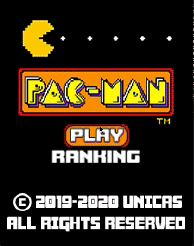
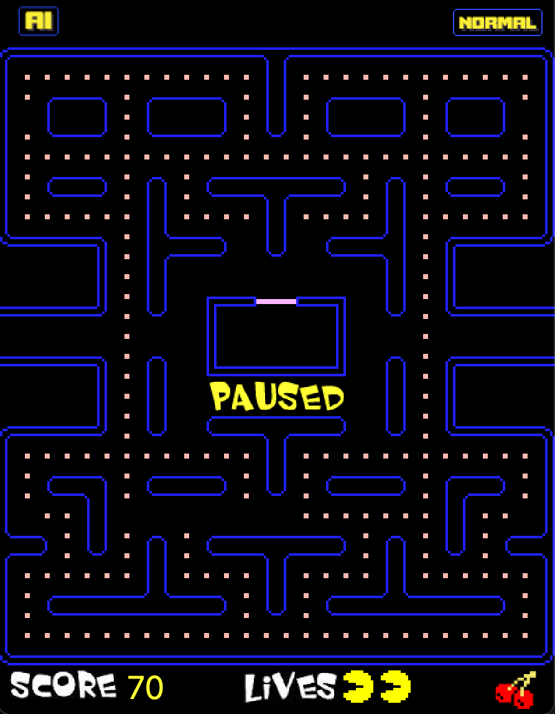
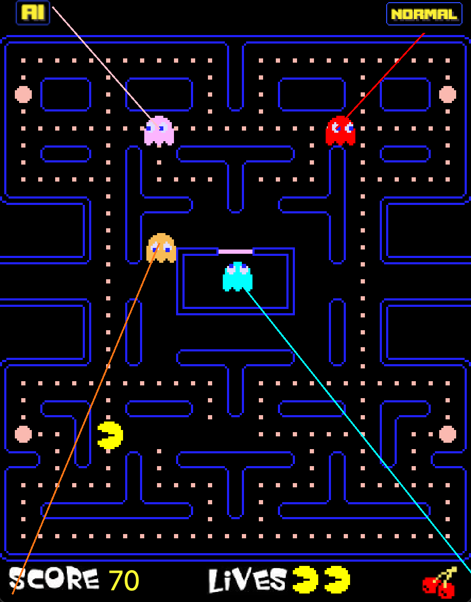
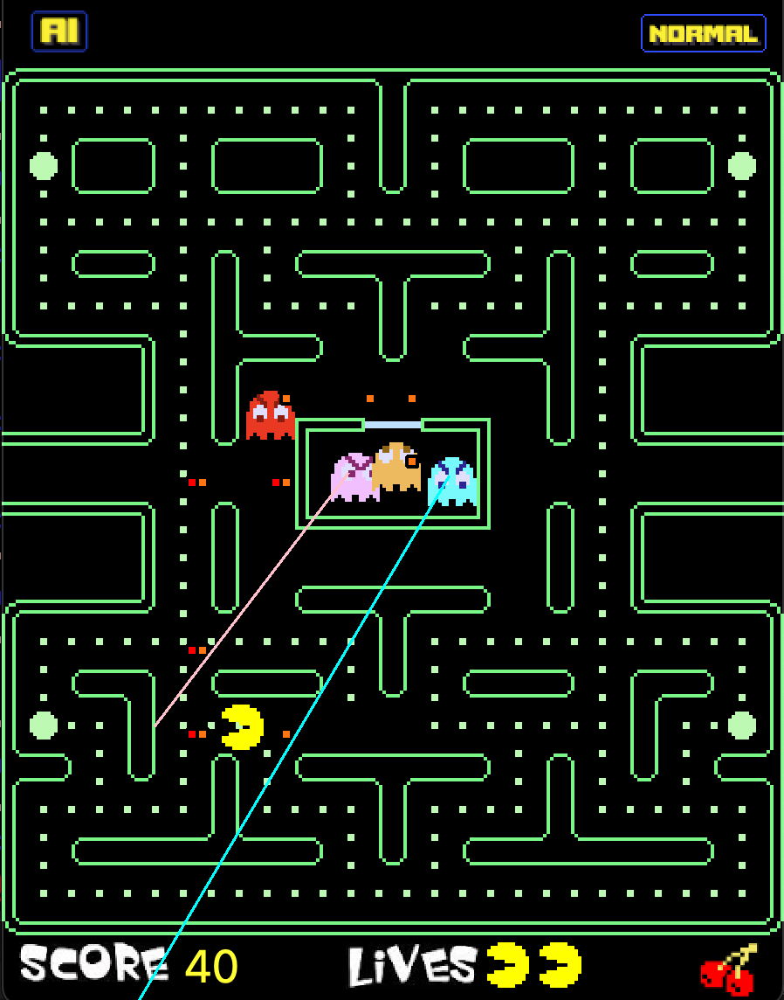
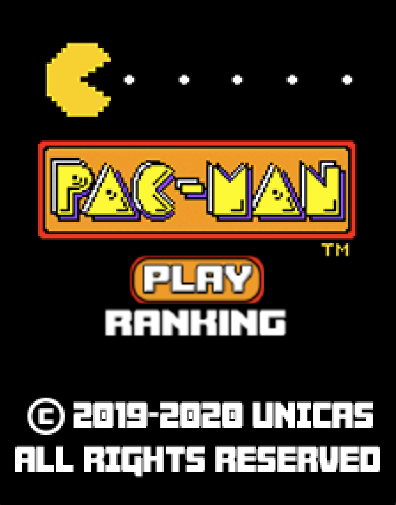
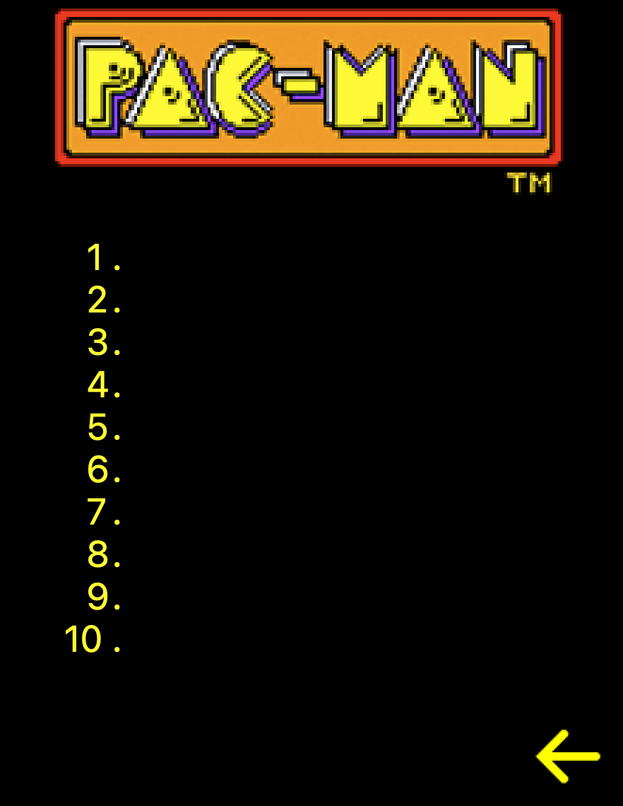
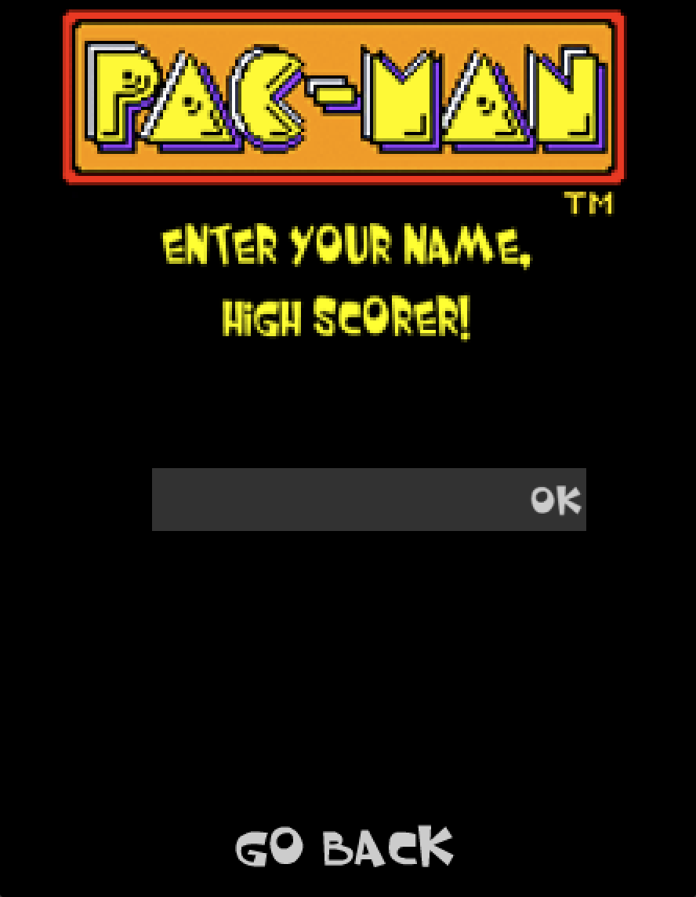

# Impossible Pac-Man

Pac-Man clone in C++/Qt 5 with a classic ghost-AI mode and an "impossible" mode where ghosts chase via precomputed shortest paths (Floyd–Warshall).

**Course project:** Programming Techniques (Tecniche di Programmazione), University of Cassino and Southern Lazio, 2020–21.



## Quick start (CLI)

```bash
# edit CMakeLists.txt lines 1–2 and CMAKE_PREFIX_PATH to match your machine (see Build notes)
cmake -S . -B build
cmake --build build
./build/impossiblepacman
```

With CMake ≥ 4 also pass `-DCMAKE_POLICY_VERSION_MINIMUM=3.5` to the first command (see [Troubleshooting](#troubleshooting)).

## Build notes

**Requirements:** Qt 5 (Widgets, Multimedia; Qt 6 won't work, see [Troubleshooting](#troubleshooting)), CMake ≥ 3.1, a C++11 compiler. Last built on macOS with Qt 5.15.2 and the Xcode toolchain.

**Hardcoded paths in `CMakeLists.txt`.** All three use `set()`, which overrides `-D` values from the command line, so they must be edited in the file on any other machine:

| Line | Setting | Value | Change it when |
|---|---|---|---|
| 1 | `CMAKE_C_COMPILER` | Xcode `cc` | Not on macOS with Xcode at `/Applications/Xcode.app` |
| 2 | `CMAKE_CXX_COMPILER` | Xcode `c++` | Same as above |
| 22 | `CMAKE_PREFIX_PATH` | `/Applications/Qt/5.15.2/clang_64/lib/cmake` | Qt 5 is installed elsewhere (e.g. Homebrew `qt@5`, Linux distro packages) |

Lines 1–2 sit before `project()`, so deleting them is enough to fall back to the default compilers.

**CMake GUI flow:**
1. Source = repo folder, build = an empty destination folder.
2. Click **Configure**, pick a generator (Unix Makefiles, Xcode, …) with **Use default native compilers**.
3. If Qt is not found, fix `CMAKE_PREFIX_PATH` in `CMakeLists.txt` (or set `Qt5Widgets_DIR` / `Qt5Multimedia_DIR` in the GUI) and configure again.
4. Click **Generate**. For Unix Makefiles, run `make` in the build folder, then `./impossiblepacman`.

**Xcode flow:**
1. `cmake -S . -B build-xcode -G Xcode`
2. Open `build-xcode/impossiblepacman.xcodeproj`.
3. Select the `impossiblepacman` target and press Run.

If configure fails with an unrecognised compiler, point the command-line tools at Xcode:
```bash
sudo xcode-select -s /Applications/Xcode.app/Contents/Developer
```

**Rules:**
- Don't move or rename the source or build folder after configuring. The build tree stores absolute paths, including the ones AUTORCC uses to embed `Resources.qrc` (all sprites and sounds), so a moved tree fails to build.
- Avoid spaces and special characters in both paths.

## Controls

| Key | Action |
|---|---|
| Arrows | Move Pac-Man |
| Enter | Start a game from the welcome screen (same as **Play**) |
| P | Pause / resume (only after the first 4 seconds of a game) |
| T | Toggle ghost targets (see below) |
| R | Reset to the welcome screen |
| D | Debug: lose a life immediately (on the last life this triggers Game Over) |
| Mouse wheel | Zoom the view in / out |

Pause:



Targets in Normal mode (a line from each ghost to its target):



Targets in AI mode (the planned paths of Blinky and Clyde, lines for Pinky and Inky):



## Game modes

The welcome screen has **Play**, **Ranking**, and two mode buttons at the top.



- **Normal** : arcade rules, see [Ghost behaviour](#ghost-behaviour).
- **AI ("impossible")** : Blinky and Clyde follow precomputed shortest paths to Pac-Man; Pinky and Inky stay in permanent Chase. Ghosts get angry sprites and the maze blinks through RGB colours.

Clicking a mode button returns to the welcome screen; then click **Play**  (or press Enter) to start in that mode.

## Ghost behaviour

| Ghost | Colour | Chase target | Scatter corner |
|---|---|---|---|
| Blinky | Red | Pac-Man's position | Top-right |
| Pinky | Pink | 26 px (≈ 3 tiles) ahead of Pac-Man | Top-left |
| Inky | Cyan | Vector rule, see below | Bottom-right |
| Clyde | Orange | Pac-Man if closer than 50 px (≈ 6 tiles), otherwise its Scatter corner | Bottom-left |

- **Pinky, facing up:** the target is 26 px up *and* 26 px left. This reproduces the arcade overflow bug on purpose.
- **Inky:** take the point 16 px (2 tiles) ahead of Pac-Man (up-and-left when Pac-Man faces up), then double the vector from Blinky to that point. This tends to trap Pac-Man between Inky and Blinky.

**Mode cycle** (Normal mode only; game clock starts at Play, including the intro jingle):

| Phase | Scatter | Chase | Game clock (s) |
|---|---|---|---|
| 1 | 7 s | 20 s | Scatter until 13, Chase until 33 |
| 2 | 7 s | 20 s | 40, 60 |
| 3 | 5 s | 20 s | 65, 85 |
| 4 | 5 s | ∞ | 90, then Chase forever |

The clock resets when Pac-Man dies or the level restarts.

- **Frightened** (after a power pellet): ghosts turn blue, slow down to 0.8 px/tick and pick a random direction at each node (never reversing). It lasts as long as the `hunt` sound.
- **Eaten:** the ghost becomes a pair of eyes, moves at 1.8 px/tick back to the gate, then resumes the current Scatter/Chase phase (or AI in AI mode).

Other rules:
- Ghosts change direction only at maze nodes.
- Ghosts move at 1.05 px/tick, Pac-Man at 1 px/tick.
- The old README claimed Blinky switches to permanent Scatter when 20 food remain. The code doesn't implement this.

## Impossible mode internals

- The maze is a graph of 76 nodes (`Entity::nodo`, neighbours in `Entity::vicini`). Edge weights are the pixel distances between adjacent nodes; the tunnel edge 27↔33 is set manually to 104.
- `Entity::calcoloDistMin()` (`Entity.cpp:807`) runs Floyd–Warshall: all-pairs shortest distances, O(n³) = 76³ ≈ 440k steps. `Entity::is_near()` (`Entity.cpp:855`) is the adjacency test.
- `Ghosts::cammino()` (`Ghosts.cpp:1215`) rebuilds the actual node path for every pair from the distance matrix. Both run once in the `Ghosts` constructor (`Ghosts.cpp:18-26`), which sets `impossible = true` just for that; the subclass constructors reset it to `false`.
- At each node, a ghost in state `AI` (`Ghosts.cpp:916`) moves to the first node of the precomputed path from its current node to Pac-Man's *destination* node. If that path is empty, it targets Pac-Man's current node.
- The mode switch is `Game::impossible`, set by `modImpossible()` / `modNormal()`. `Game::start()` forwards it with `setImpossible(true)` (sprites) and `setAi(true)` (behaviour). Blinky and Clyde turn `ai` into state `AI`; Pinky and Inky turn it into permanent `CHASE`.

## Ranking

- **Ranking**  on the welcome screen shows the top 10 scores; the yellow arrow goes back.

  

- After Game Over or You Win, the save screen appears: type a name and click **OK** to save, or **Go back** to skip.

  

- Scores are appended to `Ranking.txt` in the **current working directory** (`QFile("Ranking.txt")` in `Game.cpp`), one score line then one name line.

## Code map

Code comments and many identifiers are in Italian (`calcoloDistMin`, `distanza`, `nodo`, `cammino`, `vicini`, …).

```
QGraphicsPixmapItem
└── Object
    ├── Entity ── Pacman
    │          └── Ghosts ── Blinky, Pinky, Inky, Clyde
    └── Inert ── Food, Fruit, Life, Boxx
Game : QGraphicsView   (scenes, state machine, input, ranking)
Sounds, Sprites        (singletons / asset helpers)
```

| File | Contents |
|---|---|
| `Main.cpp` | Creates `QApplication`, the singletons, shows `Game` |
| `Game.h/.cpp` | Singleton view: scenes, buttons, game loop timer, scoring, input, ranking |
| `Object.h/.cpp` | Abstract base: adds itself to the scene, pure `animate()` / `advance()` |
| `Entity.h/.cpp` | Moving objects: maze nodes and neighbours, Floyd–Warshall |
| `Pacman.h/.cpp` | Player movement, animation, death |
| `Ghosts.h/.cpp` | Shared ghost logic: modes, movement, collisions, path reconstruction, mode clock |
| `Blinky/Pinky/Inky/Clyde.h/.cpp` | Per-ghost textures, Chase/Scatter targets, AI-mode behaviour |
| `Inert.h/.cpp` | Static objects base with an animation counter |
| `Food.h/.cpp` | Dots and power pellets; pellets trigger Frightened |
| `Fruit.h/.cpp` | Bonus cherry and its score popup |
| `Life.h/.cpp` | Life icon |
| `Box.h/.cpp` | `Boxx`: the maze image, RGB-blinking in AI mode |
| `Sounds.h/.cpp` | `QSound` singleton keyed by id |
| `Sprites.h/.cpp` | Singleton that cuts textures out of the sprite sheets |
| `Utils.h` | `Direction` and `State` enums, `Point`, texture loaders |
| `Include.h` | Umbrella include for all headers |
| `Resources.qrc` | Sprites and sounds embedded via AUTORCC |

**States:**
- `Game::Game_State` (`Game.h`): `READY`, `RUNNING`, `PAUSE`, `GAME_OVER`.
- Ghost `State` (`Utils.h`): `SCATTER`, `CHASE`, `VULNERABLE` (Frightened), `EATEN`, `AI`.

## Troubleshooting

**Re-check on 2026-10-16 (macOS, Apple Clang 21, CMake 4.4.3, Homebrew Qt 6 installed):**
- `cmake -S . -B build` fails at `CMakeLists.txt:7`: *"Compatibility with CMake < 3.5 has been removed from CMake."* Adding `-DCMAKE_POLICY_VERSION_MINIMUM=3.5` gets past it.
- `-DCMAKE_C_COMPILER` / `-DCMAKE_CXX_COMPILER` / `-DCMAKE_PREFIX_PATH` are ignored: the `set()` calls in `CMakeLists.txt` win (verified in `CMakeCache.txt`). Edit the file, or set `Qt5Widgets_DIR` / `Qt5Multimedia_DIR` instead of the prefix path.
- Configure then stops at `find_package(Qt5Widgets)` because Qt 5 isn't installed. `brew install qt@5` refuses while Homebrew's Qt 6 is linked (`brew unlink qtbase qtdeclarative qtsvg qttools` first), so the code wasn't compiled in this check. No Linux attempt was made (no container available).

**Known issues:**
- **Qt 6 doesn't work.** `QSound` was removed in Qt 6, and the CMake file looks for `Qt5::*` targets.
- **Hardcoded compiler paths.** Lines 1–2 of `CMakeLists.txt` point at Xcode; delete or edit them on other machines.
- **Ranking file location.** `Ranking.txt` lives in whatever directory the game is launched from. Launching from Xcode or another folder shows a different (or empty) ranking. If the file doesn't exist yet, the ranking screen is empty and the terminal prints `Could not open the file for reading`; the first save creates it.
- **Equal scores.** The ranking is a `QMap<int, QString>` keyed by score, so two equal scores show only one name (both stay in the file).

## Assets

Sprites and sounds come from the original arcade game and fan-made sprite sheets. They are third-party, which is why the repo is private and not for redistribution.
